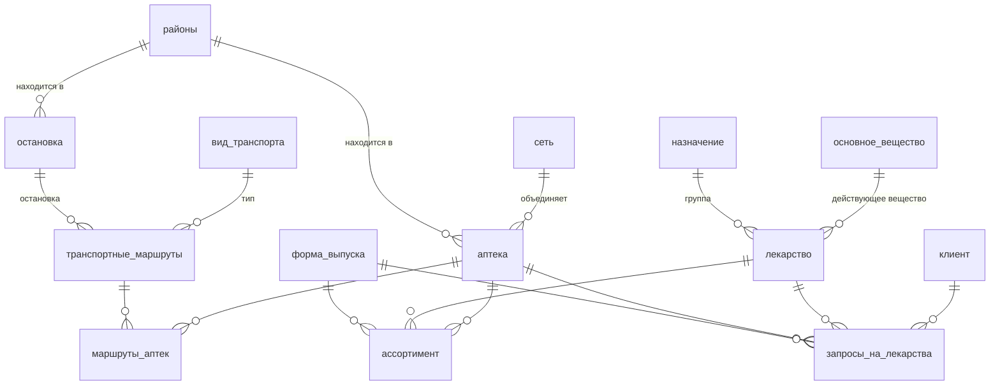

# База данных «Аптека» (MySQL)

Учебный проект по базам данных (МГТУ ГА, ИВТ, 3 курс): реляционная база для справочной службы сети аптек. Оператор по ней находит, в какой аптеке есть нужное лекарство, сколько оно стоит и как до аптеки доехать, а также ведёт обращения клиентов.

Схема перенесена из MS Access в MySQL 8 и заполнена данными. Справочник лекарств и действующих веществ собран из открытой выгрузки Государственного реестра лекарственных средств (ГРЛС): исходные данные очищены и сведены к нужным полям.

## Что внутри

| Таблиц | Лекарств | Действующих веществ | Позиций в ассортименте | Аптек | Обращений клиентов |
| --- | --- | --- | --- | --- | --- |
| 14 | 881 | 345 | 1 824 | 15 | 296 |

Аптеки, клиенты и телефоны вымышленные и созданы для тестов.

## Схема



## Файлы

| Файл | Что делает |
| --- | --- |
| `pharmacy_reset.sql` | Пересоздаёт базу с нуля: схема и данные одним скриптом. Можно запускать повторно |
| `sql/01_schema.sql` | Только схема: 14 таблиц, первичные и внешние ключи |
| `sql/02_data.sql` | Только данные (запускать после схемы) |
| `sql/03_queries.sql` | 21 запрос к базе (лабораторная работа №3) |

## Запросы

В `sql/03_queries.sql` собраны 21 запрос, сгруппированные по типам:

- **DML и DDL:** регистрация клиента, индексация цен в транзакции с `ROLLBACK`, удаление данных по запросу клиента, добавление столбца.
- **Выборки с соединениями (до 5 таблиц):** где купить лекарство от дешёвого к дорогому, как доехать до аптеки (транспорт, маршрут, остановка).
- **Агрегаты:** аптеки по сетям; минимальная, средняя и максимальная цена по группам лекарств; клиенты для программы лояльности (`HAVING`).
- **Даты и строки:** статистика обращений по месяцам, среднее время до покупки (`DATEDIFF`), подготовка списка для SMS-рассылки.
- **Подзапросы:** позиции дороже средней цены, лекарства без наличия (`NOT EXISTS`), скидка через `UPDATE` с подзапросом, `CREATE TABLE ... AS SELECT`.

## Как запустить

1. MySQL 8 и MySQL Workbench (или любой клиент MySQL).
2. Открыть `pharmacy_reset.sql` и выполнить целиком (в Workbench: Ctrl+Shift+Enter). Будет создана база `pharmacy`.
3. Открыть `sql/03_queries.sql` и выполнять запросы по одному (Ctrl+Enter).

Через консоль:

```bash
mysql -u root -p < pharmacy_reset.sql
```

## Стек

MySQL 8 · SQL (DDL, DML, JOIN, GROUP BY / HAVING, подзапросы, транзакции) · MySQL Workbench · MS Access (исходная схема)
